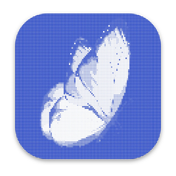
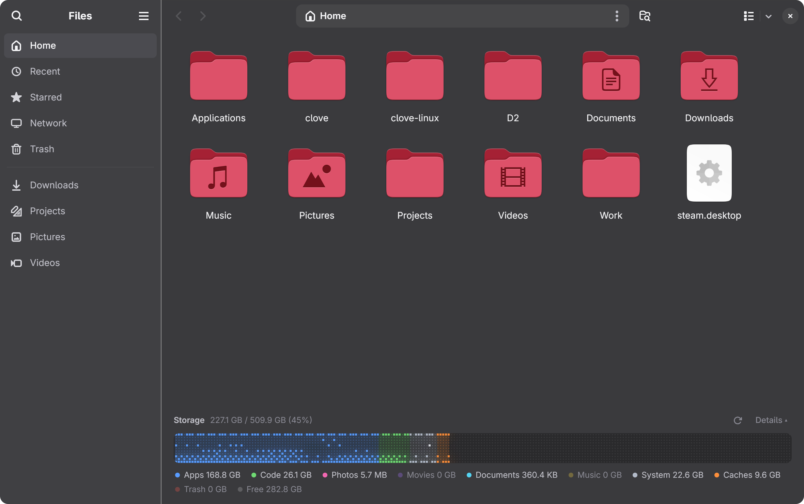

<div align="center">



# Clove for Linux

**A fast, standalone file manager for Linux (Arch / Omarchy), written in Rust.**

Originally inspired by [Keshav Bagaade's Clove](https://github.com/keshav-exe/clove) (`keshav-exe/clove`) for macOS and started as a Windows Rust port, Clove now targets Linux natively on Wayland & Vulkan with a GNOME Files (Nautilus)-inspired dark-glass interface and an animated Bayer 4×4 dithered disk usage bar.

[**Website**](https://clove-linux.vercel.app) · [**Install from AUR (`clove-linux`)**](https://aur.archlinux.org/packages/clove-linux) · [**Latest Release**](https://github.com/ZeroiJ/clove-win/releases/latest) · [**Changelog**](CHANGELOG.md) · [Build from source](#build-from-source)

<br />



</div>

## What it is

Clove (`clove-linux`) combines a clean, responsive file browser modeled on GNOME Files (Nautilus) with Clove's signature Bayer 4×4 dithered storage visualization pinned cleanly to the bottom dock. Disk scans, directory reads, thumbnail generation, watching, and trash operations all run on background threads, and the window idles at zero redraws once settled.

## Install

### Arch Linux / Omarchy (AUR)

AUR package [`clove-linux`](https://aur.archlinux.org/packages/clove-linux) is maintained automatically on every tagged release:

```bash
yay -S clove-linux
# or
paru -S clove-linux
```

### Prebuilt Linux Release Binary

Download `clove-arch.tar.gz` from the [latest GitHub Release](https://github.com/ZeroiJ/clove-win/releases/latest) (includes the `clove` binary and `clove.desktop`).

Runtime dependencies on Arch Linux: `gcc-libs`, `fontconfig`, `libxkbcommon`, `wayland`, `vulkan-icd-loader`.

## Features

- **Nautilus-inspired Linux UI** — translucent dark-glass window (`Wayland` + `wgpu`/Vulkan via Rune), centered breadcrumb/editable location bar, tabs, Details / List / Grid views (`96px` icons by default), and `192×192` media/PDF thumbnails.
- **Native system integration** — loads your active GTK/Omarchy icon theme (`Yaru-red` / `Yaru` / `Adwaita` / `hicolor`), `~/.config/gtk-3.0/bookmarks`, mounted volumes from `/proc/self/mountinfo`, plus `Recent`, `Starred`, and `Trash` views.
- **Bayer 4×4 dithered storage bar** — permanent `44px` footer bar breaking down disk usage across **Apps, Code, Photos, Movies, Documents, Music, System, Caches, Trash,** and **Free** space, with a clean inline breakdown toggle and live rescan.
- **Sub-millisecond search & tools** — instant case-folded fuzzy filtering, copy/cut/paste with conflict resolution prompts, batch rename, properties modal (size, MIME, SHA-256 checksum), directory compare, duplicate finder, and background progress tracking.
- **Guarded XDG Trash** — deletes safely to Trash with undo (`Ctrl+Z`) and strict root-escape checks.

## Keyboard Shortcuts

Press `Ctrl+/` or `F1` inside Clove to view or customize keybindings (`~/.config/clove/keybinds.txt`).

| Key | Action |
|---|---|
| Type | Filter entries in current view |
| `Ctrl+F` | Focus search bar |
| `Ctrl+L` | Edit path / location bar |
| `Ctrl+1` / `Ctrl+2` / `Ctrl+3` | Details / List / Grid view |
| `Ctrl+T` / `Ctrl+W` / `F6` | New tab / Close tab / Next tab |
| `Ctrl+H` / `F7` | Toggle hidden files |
| `Ctrl+C` / `Ctrl+X` / `Ctrl+V` | Copy / Cut / Paste |
| `Ctrl+Shift+N` / `Ctrl+Alt+N` | New folder / New empty file |
| `F2` / `Ctrl+I` | Rename / Properties & SHA-256 |
| `Delete` / `Shift+Delete` | Move to Trash / Delete permanently |
| `Ctrl+Z` | Undo last trash |
| `↑` `↓` `Home` `End` `Enter` `Backspace` | Navigate selection / open / go up |

## Build from source

Requires Rust / Cargo (`base-devel`, `rust`, `cargo`, `git`, `libxkbcommon`, `wayland`, `fontconfig`) and the pinned [Rune](https://github.com/anomalyco/rune) checkout (`db301c06ab0d68b70c4822a542fffc6615bbd419`):

```bash
git clone https://github.com/ZeroiJ/clove-win.git
cd clove-win

# Fetch the pinned Rune checkout (git-ignored, required to build)
git clone --depth 1 https://github.com/anomalyco/rune.git prototypes/_rune-upstream
git -C prototypes/_rune-upstream fetch --depth 1 origin db301c06ab0d68b70c4822a542fffc6615bbd419
git -C prototypes/_rune-upstream checkout db301c06ab0d68b70c4822a542fffc6615bbd419

cd clove-rs
cargo build -p clove-ui --release --locked
./target/release/clove
```

Or build and install into `~/.local/bin` and `~/.local/share/applications` on Arch:

```bash
./scripts/install-arch.sh
```

Run workspace tests or the headless CLI:

```bash
cd clove-rs
cargo test --workspace --locked
cargo run -p clove-cli -- scan
```

## Project layout

```text
clove-rs/
  crates/
    clove-fs/      filesystem engine: listing, case-folding, watching, storage scan
    clove-search/  sub-millisecond fuzzy/substring filter
    clove-render/  deterministic Bayer 4x4 dithered storage bar + design tokens
    clove-shell/   XDG Trash / undo safety guards
    clove-cli/     headless CLI: list, find, bar, bench, scan
    clove-ui/      Rune Wayland/Vulkan desktop app
packaging/
  aur/             AUR PKGBUILD + .SRCINFO for clove-linux
  arch/            local Arch PKGBUILD & desktop entry
scripts/           Arch local user installer
Clove/             original upstream macOS reference app
```

## Credits & Origins

- **Original project:** [Clove](https://github.com/keshav-exe/clove) by [Keshav Bagaade](https://github.com/keshav-exe) ([kshv.me/clove](https://www.kshv.me/clove)), MIT licensed — created the original macOS app and signature dithered storage visualization that inspired this Rust/Linux port.
- **UI/UX inspiration:** [GNOME Files (Nautilus)](https://apps.gnome.org/Nautilus/) layout adapted for Arch Linux / Omarchy dark glass themes.
- **UI framework:** [Rune](https://github.com/anomalyco/rune) by Anomaly — Rust GPU UI framework.
- the icon was taken from here :- https://pin.it/ygCGJ3lxo

## License

MIT — see [LICENSE](LICENSE).
